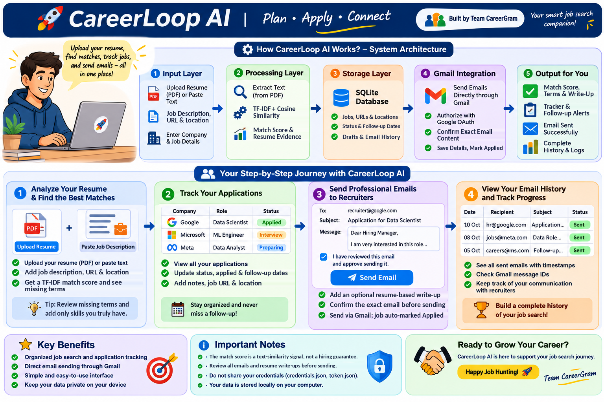

# 🚀 CareerLoop AI
### Your Smart Job Search Companion

**Built with ❤️ by Team CareerGram**

CareerLoop AI is a Python and Streamlit-based job search assistant that helps users compare resumes with job descriptions, track job applications, and send recruiter emails directly through Gmail, always after explicit confirmation.

The goal is to make the job search more organized by bringing resume matching, application tracking, follow-up dates, and email communication into one simple application.

---

## 🏗️ System Architecture

The following diagram explains how CareerLoop AI works, from user input to resume analysis, local storage, Gmail integration, and email history.



### 🔄 How CareerLoop AI Works

1. **Add your resume:** Upload a PDF resume or paste resume text in the sidebar.
2. **Add a job:** Enter the job title, company, job URL, location, and job description.
3. **Match:** The app compares your resume with the job description using TF-IDF and cosine similarity, and lists terms found in both texts and job terms missing from your resume.
4. **Track:** Update the status, date applied, follow-up date, and notes for each job in a local SQLite database.
5. **Prepare an email:** Write a recruiter email, optionally linked to a saved job, with an optional evidence-based write-up built from your resume.
6. **Review and confirm:** Check the email and tick the confirmation box for that exact content.
7. **Send through Gmail:** The app sends the email with the Gmail API and, if you choose, marks the linked job as **Applied**.
8. **Review history:** View sent emails, timestamps, linked jobs, and Gmail message IDs.

---

## ✨ Key Features

### 📄 1. Resume and Job Matching
- Upload a PDF resume or paste resume text.
- Match score uses **TF-IDF (single words and two-word phrases) with cosine similarity**.
- See terms found in both texts and job terms not found in your resume, ranked by how often they appear in the job description.
- Re-run the match for any saved job after updating your resume.
- Your resume text is saved in the local database so you don't have to re-upload it each time. You can delete it from the sidebar.

### 📋 2. Job Application Tracker
- Save company, role, **job URL**, and **location**.
- Track status: Saved, Preparing, Applied, Interview, Offer, Rejected, Withdrawn.
- Record the **date applied** and a **follow-up date**.
- Add notes and edit any job detail later.
- Overdue follow-ups show a warning in the tracker (jobs that are Rejected, Offer, or Withdrawn are excluded).
- The Overview tab shows totals for jobs, applications, interviews, and offers.

### ✍️ 3. Evidence-Based Write-Up
- The app selects the sentences in your resume that are most similar to the job description.
- It builds a short paragraph from those sentences only. Nothing is invented or embellished.
- If no resume sentence matches closely enough, no write-up is produced.
- You can include or exclude it in the email, and you can edit the text freely.
- You are still responsible for checking every statement before sending.

### 📧 4. Direct Recruiter Email Sending
- Write emails with a recipient, subject, and message.
- Optionally link an email to a saved job; the subject and body are pre-filled from the job and your profile name.
- Review a preview before sending.
- **The confirmation checkbox applies to the exact recipient, subject, and message.** If you change any of them, or after a successful send, you must confirm again.
- Send through the Gmail API and record the Gmail message ID.
- Optional: after a successful send, automatically mark the linked job as **Applied** and set today as the date applied. This only changes jobs that are Saved or Preparing, never later stages such as Interview or Offer.
- Save drafts locally and load them back into the send form.
- Optionally copy a local draft into Gmail Drafts (available only if your `gmail_service.py` provides `create_draft`).

**Important:** CareerLoop AI never sends an email automatically. You must review the email and check the confirmation box before clicking Send.

### 🕘 5. Email History
- View every email sent from the app.
- See the recipient, subject, linked job, timestamps, message, and Gmail message ID.

---

## 🛠️ Technologies Used

| Technology | Purpose |
|---|---|
| Python | Main programming language |
| Streamlit | Web application interface |
| PyMuPDF | Extract text from PDF resumes |
| scikit-learn | TF-IDF vectorization and cosine similarity |
| pandas | Tables in the Overview and tracker views |
| SQLite | Store jobs, drafts, and email records locally |
| Gmail API | Send recruiter emails |
| Google OAuth 2.0 | Authorize access to Gmail |
| Google API Python Client | Communicate with Google APIs |
| python-dotenv | Load environment variables (optional) |
| unittest | Test matching logic |

---

## 📁 Project Structure

```text
CareerLoop_AI/
│
├── app.py                  # Main Streamlit application
├── gmail_service.py        # Gmail API integration
├── requirements.txt        # Python dependencies
├── README.md               # Project documentation
├── .env.example            # Example environment variables
├── .gitignore              # Files excluded from Git
├── careerloop.db           # Local database (created at runtime)
│
├── credentials.json        # Google OAuth credentials (private)
├── token.json              # Authorized Google token (private)
│
├── assets/
│   └── careerloop-architecture.png
│
└── tests/
    └── test_matching.py    # Tests for matching logic
```

**Note:** `careerloop.db`, `credentials.json`, and `token.json` are local files. They should not be committed to GitHub. The database is created when the application starts.

---

## 💻 Requirements

Before starting, make sure you have:

- Windows 10 or Windows 11
- Python 3.11 recommended
- Git (optional, for cloning the repository)
- A Google account
- An internet connection for Google OAuth authorization and Gmail API access

Your `requirements.txt` should include at least:

```text
streamlit
pymupdf
scikit-learn
pandas
python-dotenv
google-api-python-client
google-auth-httplib2
google-auth-oauthlib
```

---

## ⚙️ Installation and Setup

### Step 1: Get the project

If the project is on GitHub, clone your repository:

```bash
git clone YOUR_GITHUB_REPOSITORY_URL
cd CareerLoop_AI
```

Alternatively, download the project ZIP and extract it.

Replace `YOUR_GITHUB_REPOSITORY_URL` with your actual repository URL.

### Step 2: Create a virtual environment

Open Command Prompt or PowerShell inside the project folder.

```bash
py -3.11 -m venv .venv
```

### Step 3: Activate the virtual environment

For Windows PowerShell:

```powershell
.\.venv\Scripts\Activate.ps1
```

For Windows Command Prompt:

```cmd
.venv\Scripts\activate.bat
```

### Step 4: Install dependencies

```bash
python -m pip install --upgrade pip
pip install -r requirements.txt
```

### Step 5: Configure Gmail API

Follow the Gmail setup instructions below before using the recruiter email feature.

### Step 6: Run CareerLoop AI

```bash
streamlit run app.py
```

Streamlit will provide a local URL, usually:

```text
http://localhost:8501
```

Open the URL in your browser to use the application.

---

## 📬 Gmail API Setup

CareerLoop AI uses Google's Gmail API to send emails directly from your Gmail account.

### Step 1: Create a Google Cloud project

1. Open the [Google Cloud Console](https://console.cloud.google.com/).
2. Create a new project or select an existing project.
3. Open **APIs & Services → Library**.
4. Search for **Gmail API**.
5. Enable the Gmail API for your project.

### Step 2: Configure OAuth consent

1. Open **Google Auth Platform** or the OAuth consent configuration in Google Cloud Console.
2. Configure the app details and audience.
3. If the application is in testing mode, add your Google account as a test user where required.
4. Save the configuration.

The exact labels may differ slightly depending on the Google Cloud Console interface.

### Step 3: Create OAuth credentials

1. Open **APIs & Services → Credentials**.
2. Create an OAuth client ID.
3. Choose **Desktop app** as the application type.
4. Download the JSON credentials file.
5. Rename it to `credentials.json`.
6. Place it in the same directory as `app.py`.

Your project should now contain:

```text
CareerLoop_AI/
├── app.py
├── gmail_service.py
└── credentials.json
```

### Step 4: Authorize Gmail

Run the application, open the **Gmail connection** tab, and click **Authorize / test Gmail access**. You can also trigger authorization the first time you send an email.

Follow the browser prompts, sign in to the intended Google account, and approve the requested permission. After authorization, the service stores a local token file named `token.json`.

The application needs a Gmail scope that allows sending. The standard sending scope is:

```text
https://www.googleapis.com/auth/gmail.send
```

This scope allows sending email through the Gmail API; it does not provide general permission to read your inbox.

> **Using "Copy to Gmail Drafts"?** Creating Gmail drafts requires the `gmail.compose` scope instead (which also allows sending). If you change the scopes in `gmail_service.py`, delete `token.json` and authorize again.

### Step 5: Send a test email

1. Open the **Recruiter email** tab.
2. Enter your own email address as the recipient.
3. Write a test subject and message.
4. Review all details carefully.
5. Check the confirmation box.
6. Click **Send email**.
7. Check Gmail's Sent folder and the application's **Email history** tab.

For a test, link no job (or untick "mark the linked job as Applied") so your tracker is not changed.

**Important:** If an error occurs after clicking Send, check Gmail's Sent folder before retrying. This helps avoid sending the same email twice.

---

## 🗄️ Database and Upgrading from Older Versions

All data is stored in `careerloop.db` next to `app.py`. The app creates and upgrades the tables automatically on startup.

| Table | Purpose |
|---|---|
| `jobs` | Tracked jobs: company, role, URL, location, description, match score, matching/missing terms, status, dates, notes |
| `email_records` | Emails sent through Gmail, with linked job and Gmail message ID |
| `email_drafts` | Drafts saved locally (and optionally copied to Gmail Drafts) |
| `settings` | Profile name and saved resume text |

**Upgrading from the earlier keyword-only version:**
- The old `applications` table is copied into `jobs` automatically, once per row. The old table is left untouched.
- The old status "Not applied" becomes "Saved", and empty job titles become "Untitled role".
- Old `email_records` are re-linked to the migrated jobs through a new `job_id` column.
- The old stored resume text per application is not carried over.
- **Back up `careerloop.db` before running the new version.**

---

## 🧪 Running Tests

CareerLoop AI includes basic unit tests for the matching logic.

Run the following command from the project root:

```bash
python -m unittest discover -s tests
```

These tests check the matching logic. They do not verify Gmail authorization, real email delivery, or the complete Streamlit application. If your tests were written for the earlier keyword-overlap function, update them for the TF-IDF scoring and the term lists.

For the Gmail integration, use your own account to send a test email before using the application for real recruiter communication.

---

## 🔐 Security and Privacy

Please follow these security practices when using CareerLoop AI:

- **Protect OAuth credentials:** Never upload `credentials.json` or `token.json` to a public repository.
- **Protect personal data:** The local SQLite database contains job details, your saved resume text, and email records. Do not share it publicly.
- **Use `.gitignore`:** Exclude credentials, tokens, environment files, database files, and virtual environments from Git.
- **Review before sending:** Always verify the recipient, subject, and email body before confirming.
- **Understand Gmail permissions:** Grant access only to the Google account you intend to use.
- **Use trusted devices:** Anyone with access to your local files or authorized session may be able to access stored information.
- **Resume processing:** Resume text is processed locally and is not sent to any AI service.

If you have already committed credentials or tokens to a public repository, removing the files from the latest commit may not be enough. Revoke or rotate the exposed credentials and review the repository history.

---

## ⚠️ Current Limitations

- The match score is a TF-IDF text-similarity signal, not a trained AI model and not a hiring probability.
- A high match score does not guarantee an interview or job offer.
- Text similarity may miss skills expressed using different words or phrases, and the term lists are text overlaps, not verified skills.
- The write-up reuses sentences from your resume; it does not understand context, so always review and edit it.
- PDF resumes must contain selectable text. Scanned image-only PDFs will not work.
- Emails are sent as plain text and without attachments.
- Email history reflects the records saved by this application; it is not a complete synchronization of your Gmail account.
- Follow-up dates are shown as warnings inside the app; the app does not send reminders.
- Email delivery, Gmail quotas, and OAuth access depend on Google's services and account configuration.
- The project requires Google OAuth setup before direct email sending can work.

---

## 🚀 Future Improvements

Possible future enhancements include:

- Semantic resume and job-description matching.
- Better skill extraction and categorization.
- Resume improvement suggestions based on job requirements.
- Resume attachments for emails.
- Search, filtering, and analytics for job applications.
- More detailed email status tracking.
- Improved automated tests and deployment support.

These are potential future features and are not necessarily implemented in the current version.

---

## 🤝 Contributing

Contributions, suggestions, and feedback are welcome!

1. Fork the repository.
2. Create a new branch for your changes.
3. Make your changes and test them.
4. Submit a pull request with a clear explanation.

Please do not include real resumes, personal email records, OAuth tokens, or other private information in contributions.

---

## 📢 Connect With Us

Want more updates on **Artificial Intelligence, Machine Learning, Data Science, and practical AI projects**? Follow us!

- 📱 **WhatsApp Channel:** [Follow us for AI updates](https://whatsapp.com/channel/0029VbARpEB7T8bYWCeDN61H)
- 📸 **Instagram:** [Follow us on Instagram](https://www.instagram.com/thecareergram?igsh=M2l2Y2lpcHZ4ZjVj)
- 💻 **GitHub:** Explore more projects and learning resources on our GitHub profile.

⭐ If you find **CareerLoop AI** useful, please consider giving this repository a **star** and sharing it with others!

💡 Follow us to learn, build, and grow together in AI and Data Science.

---

## 📄 License

Choose a license before distributing the project publicly. If you decide to use the MIT License, add a `LICENSE` file containing the appropriate MIT License text and copyright details.

---

**Built with ❤️ by Team CareerGram**